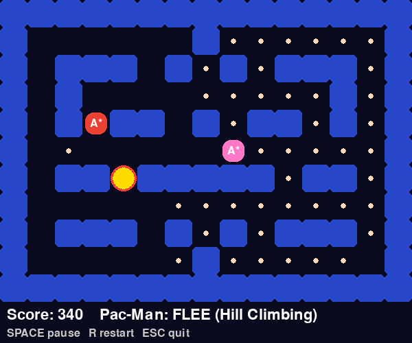

# Pac-Man Search AI

A fully automatic Pac-Man game where three classic search algorithms play different roles: Pac-Man uses **BFS** to find food and **Hill Climbing** to run away, while the ghosts use **A_star** to hunt him down.



## How the AI works

| Character | Algorithm | What it does |
|---|---|---|
| Pac-Man (EAT mode) | **BFS** | Searches outwards from Pac-Man until it reaches any pellet. Because BFS explores cells in order of distance, the first pellet it finds is always the nearest one. |
| Pac-Man (FLEE mode) | **Hill Climbing** | When a ghost comes within 2 cells, Pac-Man scores each neighbouring cell by its distance to the nearest ghost and moves to the safest one. If no neighbour is safer than where he is, he stays put. |
| Ghosts | **A_star** | Each ghost finds the shortest path to Pac-Man using `f = g + h`, where `g` is the distance travelled so far and `h` is the Manhattan distance to Pac-Man. |

Pac-Man's mode is shown at the bottom of the screen, and a red ring appears around him while he is fleeing.

## What I learned

- **BFS is the right tool for "find the nearest thing".** It doesn't need to know where the pellets are in advance; it simply finds whichever one is closest.
- **A_star finds the same shortest path as BFS, but explores far fewer cells**, because the heuristic steers the search towards the goal. The heuristic must never overestimate the real distance, and Manhattan distance satisfies this on a grid with four-directional movement.
- **Hill Climbing is fast but short-sighted.** It only looks one step ahead, so Pac-Man can flee straight into a dead end and get trapped. This is the local optimum problem, and you can watch it happen in the game.
- **Two ghosts running the same A_star merge into one.** While testing, I noticed that once two ghosts' paths overlapped, they moved together as a single ghost. Making each ghost treat the other ghosts as walls while planning fixed this, and as a bonus the second ghost now takes a different route and tries to cut Pac-Man off.

## Run it

```bash
pip install pygame
python python Pacman.py
```

| Key | Action |
|---|---|
| `SPACE` | Pause / resume |
| `R` | Restart |
| `ESC` | Quit |

## Settings

You can change these values at the top of the game framework in `pacman_ai.py`:

| Setting | Default | Meaning |
|---|---|---|
| `PAC_EVERY` | `10` | Pac-Man moves one cell every N frames (lower is faster) |
| `GHOST_EVERY` | `28` | Ghosts move one cell every N frames (lower is faster) |
| `DANGER` | `2` | How close a ghost must be before Pac-Man starts fleeing |
| `GHOSTS_ON` | `True` | Set to `False` to watch Pac-Man's BFS on its own |

## Credits

The game framework (rendering and game loop) was built with the help of an AI assistant.
I implemented the three search algorithms: BFS, A_star and Hill Climbing.